<div align="center">

<p align="center">
    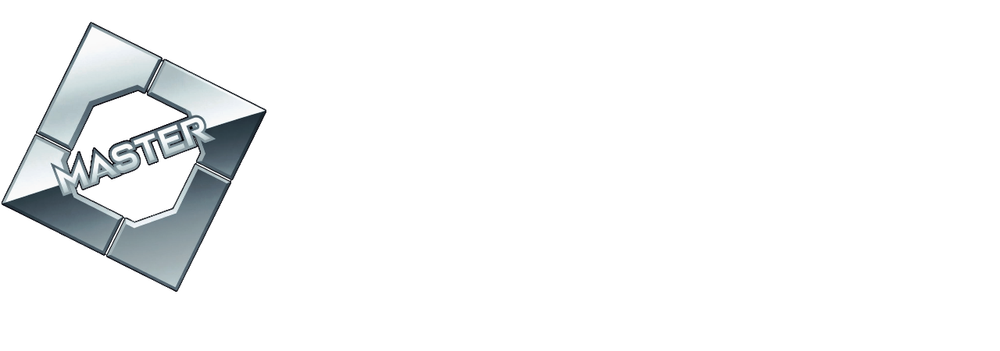
    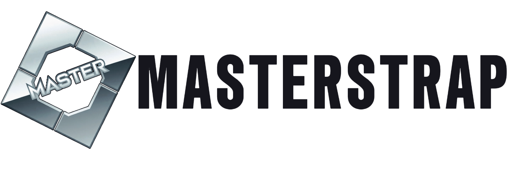
</p>

*A modern, fast, and secure bootstrapper / fastflag manager for Roblox.*

[](https://github.com/Masterstrap/Masterstrap/releases/tag/Masterstrap)
[](https://github.com/Masterstrap/Masterstrap/blob/main/LICENSE)
[](https://github.com/Masterstrap/Masterstrap/releases)
[](https://discord.com/invite/T7ntt9dq3e)

**Windows** · **Linux** · **Android** · **iOS** · **macOS** *(coming soon)*

</div>

---

## **What Is Masterstrap**

**Masterstrap is an open source project distributed under a commercial model where we sell the compiled software. By making the source code fully public, we ensure absolute transparency and proven security, delivering a premium, risk free environment unlike generic free utilities that often compromise your system with unverified hidden scripts.**


## Star History

<a href="https://www.star-history.com/?repos=masterstrap%2Fmasterstrap&type=date&legend=top-left">
 <picture>
   <source media="(prefers-color-scheme: dark)" srcset="https://api.star-history.com/chart?repos=masterstrap/masterstrap&type=date&theme=dark&legend=top-left" />
   <source media="(prefers-color-scheme: light)" srcset="https://api.star-history.com/chart?repos=masterstrap/masterstrap&type=date&legend=top-left" />
   
 </picture>
</a>

---

## 📦 Platforms

| Platform | Status | How to get it |
| :--- | :---: | :--- |
| 🪟 **Windows** 10 / 11 (x64) | ✅ Available | Command below, or `Masterstrap.exe` from [Releases](https://github.com/Masterstrap/Masterstrap/releases/latest) |
| 🐧 **Linux** (x86_64, incl. WSL2) | ✅ Available | Command below, or `Masterstrap-linux-x64.tar.gz` from [Releases](https://github.com/Masterstrap/Masterstrap/releases/latest) |
| 🤖 **Android** | ✅ Available | [Google Play](https://play.google.com/store/apps/details?id=com.masterstrap.app) or APK on [masterstrap.org/download](https://masterstrap.org/download/) |
| 🍎 **iOS** | ✅ Available | IPA on [masterstrap.org/download](https://masterstrap.org/download/) |
| 💻 **macOS** | 🕒 Coming soon | Follow the [Discord](https://discord.gg/masterstrap) for the release |

---

## 🛠️ Installation

### 🪟 Windows

Open **PowerShell** and run:

```powershell
irm https://github.com/Masterstrap/Masterstrap/releases/latest/download/Masterstrap.exe -OutFile "$env:TEMP\Masterstrap.exe"; Start-Process "$env:TEMP\Masterstrap.exe"
```

Or download `Masterstrap.exe` from the [latest release](https://github.com/Masterstrap/Masterstrap/releases/latest) and run it.

### 🐧 Linux

Open a terminal and run (no `sudo` needed, everything goes into your home folder):

```bash
curl -fsSL https://dl.masterstrap.org/linux/install.sh | bash
```

Then start **Masterstrap** from your app menu, or run `masterstrap`. Run the same command again to update.

To uninstall:

```bash
curl -fsSL https://dl.masterstrap.org/linux/install.sh | bash -s -- --uninstall
```

> Roblox runs on Linux through the [mocktail](https://github.com/komaruworld/mocktail) runtime (Apache-2.0), which the installer downloads and verifies for you.

### 🤖 Android / 🍎 iOS

Get the app from [Google Play](https://play.google.com/store/apps/details?id=com.masterstrap.app), or download the APK / IPA from [masterstrap.org/download](https://masterstrap.org/download/).

---

<details open>
<summary><b>View Features in Action</b></summary>
<br/>

<table width="60%" align="center" style="margin: 0 auto; border-collapse: collapse;">
  <tr>
    <td valign="top" style="padding: 12px;">
      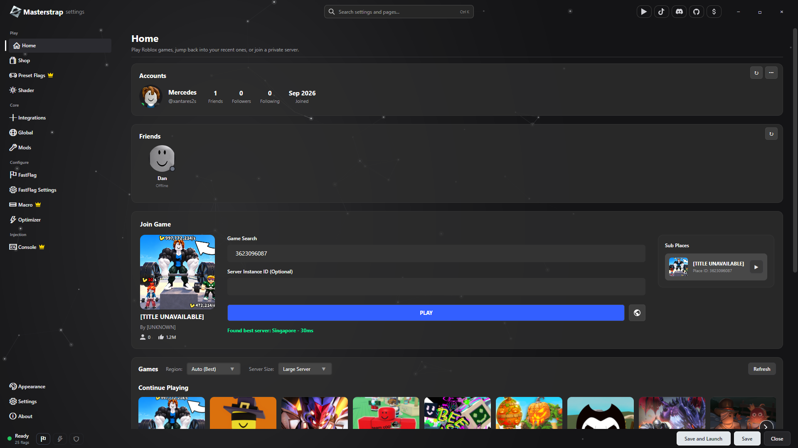
      <br/><br/>
      <h3>🏠 Home</h3>
      <p><i>Accounts, friends, join any game or server instance, best-region server finder and your recent games</i></p>
    </td>
    <td valign="top" style="padding: 12px;">
      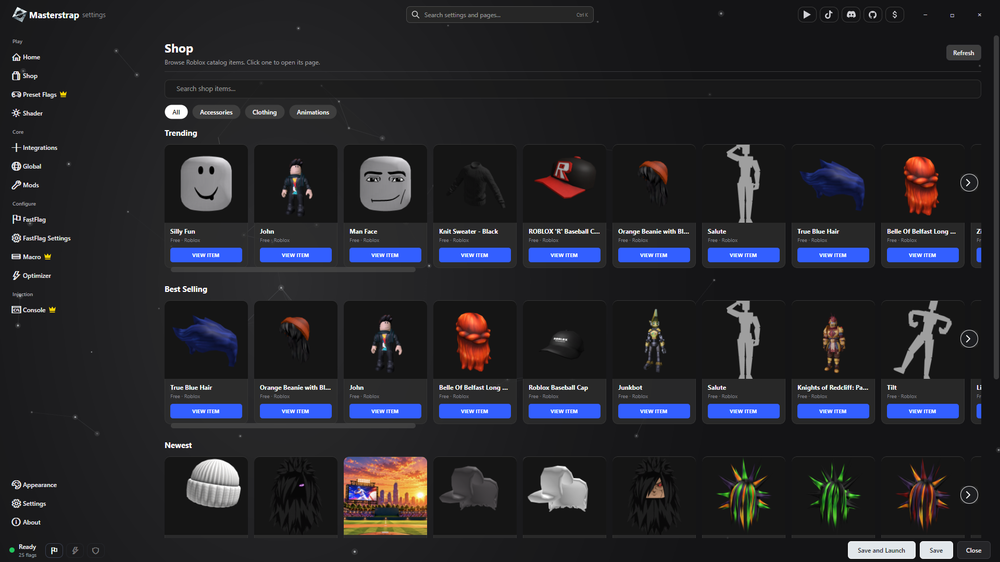
      <br/><br/>
      <h3>🛒 Shop</h3>
      <p><i>Pick a package and unlock premium features right inside the app</i></p>
    </td>
  </tr>

  <tr>
    <td valign="top" style="padding: 12px;">
      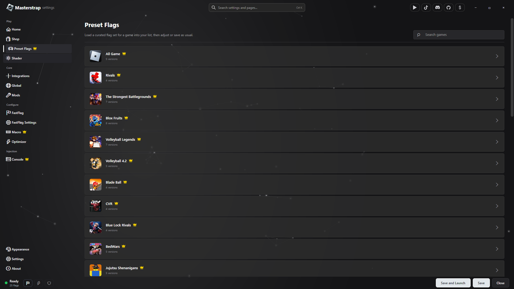
      <br/><br/>
      <h3>🎮 Preset Flags</h3>
      <p><i>Curated flag sets for each game (Rivals, The Strongest Battlegrounds, Blox Fruits, Blade Ball...)</i></p>
    </td>
    <td valign="top" style="padding: 12px;">
      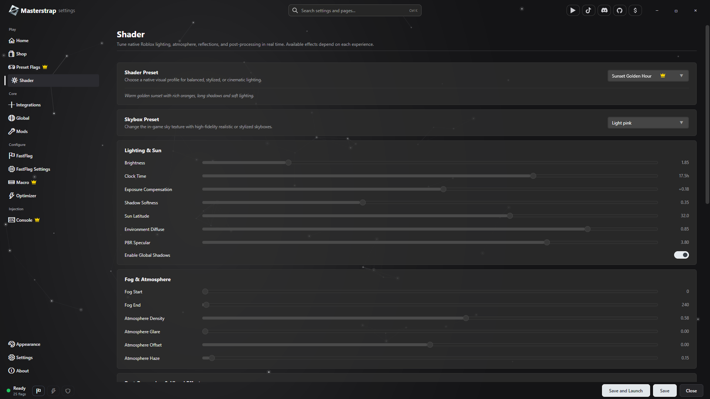
      <br/><br/>
      <h3>✨ Shader</h3>
      <p><i>Tune lighting, sun, fog and atmosphere in real time, with shader and skybox presets</i></p>
    </td>
  </tr>

  <tr>
    <td valign="top" style="padding: 12px;">
      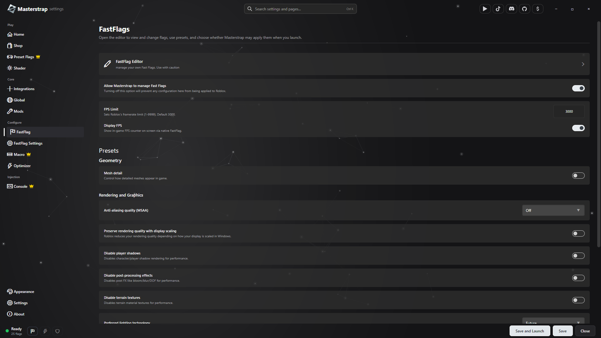
      <br/><br/>
      <h3>⚡ FastFlag Manager</h3>
      <p><i>Manage your fastflags without editing the original file</i></p>
    </td>
    <td valign="top" style="padding: 12px;">
      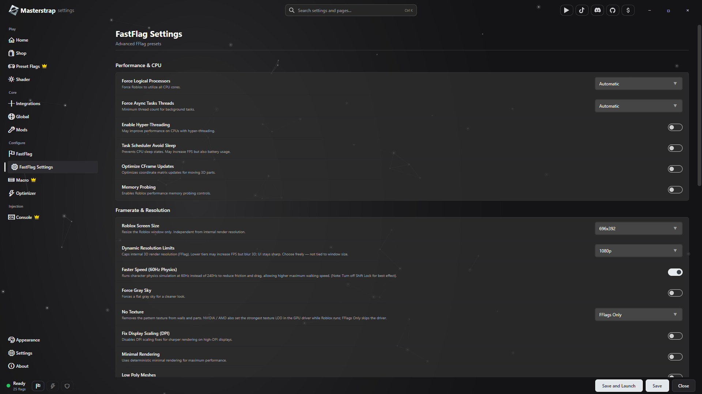
      <br/><br/>
      <h3>🚀 FastFlag Settings</h3>
      <p><i>Ready-made flags available in the software (gray sky, disable shadows, FPS...)</i></p>
    </td>
  </tr>

  <tr>
    <td valign="top" style="padding: 12px;">
      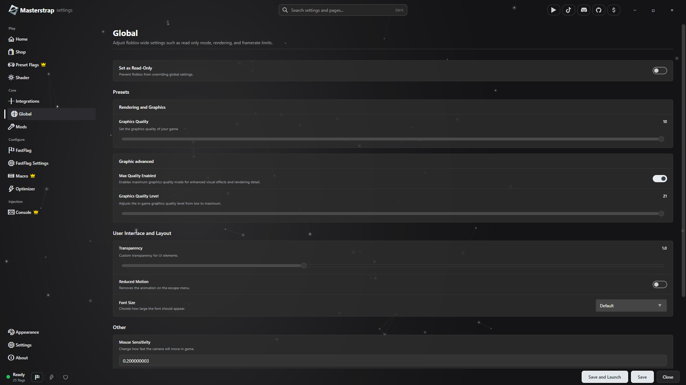
      <br/><br/>
      <h3>🌍 Global</h3>
      <p><i>Roblox's own settings, set from one place</i></p>
    </td>
    <td valign="top" style="padding: 12px;">
      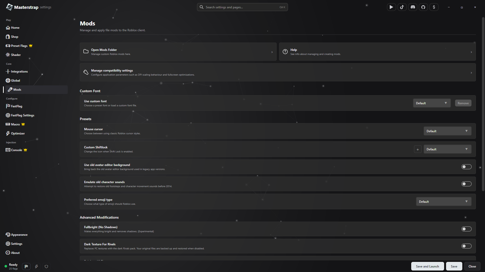
      <br/><br/>
      <h3>⚙️ Mods</h3>
      <p><i>Safe visual mods (skybox, crosshair, mouse cursor) without risking your account</i></p>
    </td>
  </tr>

  <tr>
    <td valign="top" style="padding: 12px;">
      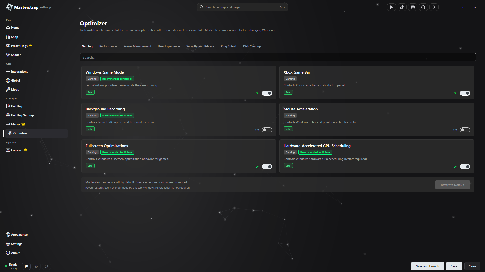
      <br/><br/>
      <h3>🔧 Optimizer</h3>
      <p><i>Gaming, performance, power and privacy tweaks plus Ping Shield; every switch can be reverted</i></p>
    </td>
    <td valign="top" style="padding: 12px;">
      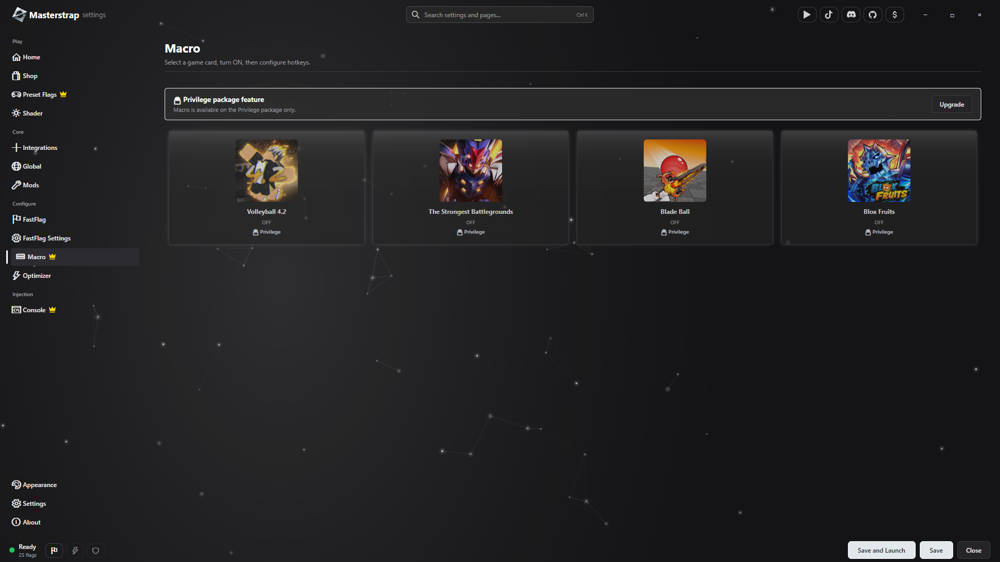
      <br/><br/>
      <h3>⌨️ Macro</h3>
      <p><i>Per-game hotkey macros (Volleyball 4.2, The Strongest Battlegrounds, Blade Ball, Blox Fruits)</i></p>
    </td>
  </tr>

  <tr>
    <td valign="top" style="padding: 12px;">
      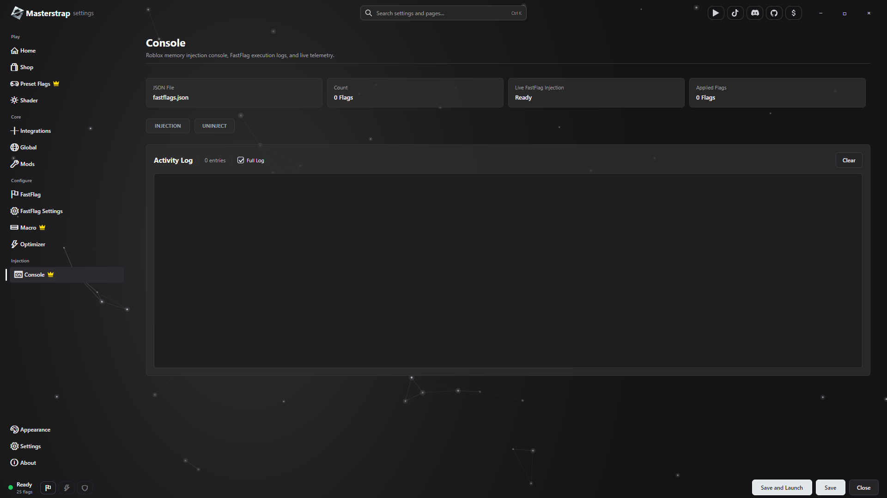
      <br/><br/>
      <h3>🖥️ Console</h3>
      <p><i>Live FastFlag injection with an activity log</i></p>
    </td>
    <td valign="top" style="padding: 12px;">
      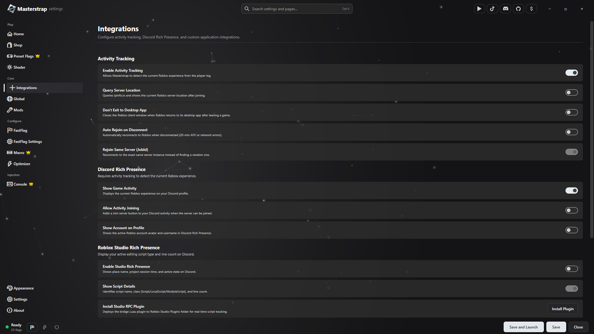
      <br/><br/>
      <h3>🔌 Integrations</h3>
      <p><i>Activity tracking, auto rejoin, Discord and Roblox Studio Rich Presence</i></p>
    </td>
  </tr>

  <tr>
    <td valign="top" style="padding: 12px;">
      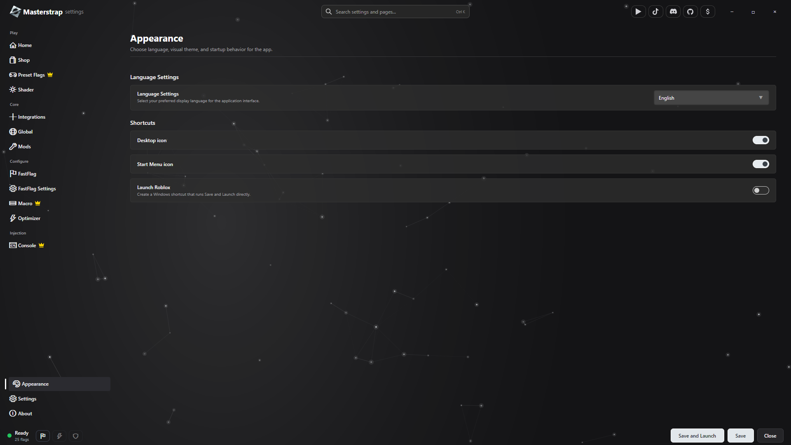
      <br/><br/>
      <h3>🎨 Appearance</h3>
      <p><i>Themes and the look of the launcher</i></p>
    </td>
    <td valign="top" style="padding: 12px;">
      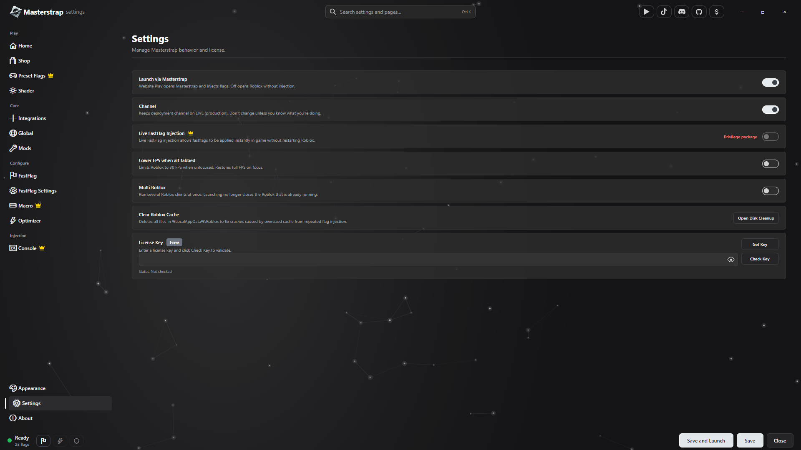
      <br/><br/>
      <h3>🔒 Settings</h3>
      <p><i>Launch via Masterstrap, Live FastFlag Injection, Multi Roblox and your license key</i></p>
    </td>
  </tr>
</table>
</details>

---

## ✨ Key Features

| | Tabs | Function |
| :---: | :--- | :--- |
| 🏠 | **Home** | Accounts, friends, join games / private servers, best-region server finder |
| 🎮 | **Preset Flags** | Curated flags for each game, extremely effective |
| ✨ | **Shader** | Real-time lighting, atmosphere and skybox presets |
| ⚡ | **FastFlag** | Manage your fastflags without editing the original file |
| 🛠️ | **FastFlag Settings** | Edit the flags available in the software |
| 🌍 | **Global** | Set up preset settings in Roblox |
| ⚙ | **Mods** | Visual tweaks that are safe in-game (skybox, crosshair, mouse cursor) |
| 🔧 | **Optimizer** | System tweaks and Ping Shield, each one reversible |
| ⌨️ | **Macro** | Hotkey macros for supported games |
| 🖥️ | **Console** | Live FastFlag injection and logs |
| 🔌 | **Integrations** | Discord Rich Presence, activity tracking, auto rejoin |
| 📦 | **Auto Update** | Every new version of Roblox is picked up automatically |

---

## Community & Support
* Join the Masterstrap Discord https://discord.gg/masterstrap to get updates, discuss development, and share FastFlags

---

## Developers
* [Dan](https://discord.com/users/923252600952979477)

---
